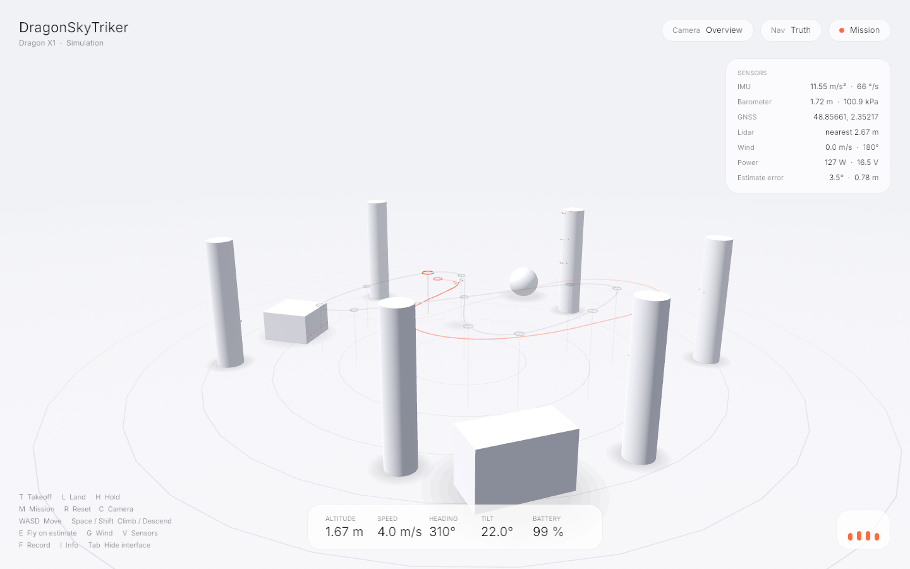

# DragonSkyTriker

Simulateur de drones basé sur **Bevy 0.20** : physique, capteurs réalistes, estimation d'état, mondes en JSON, et un rendu épuré.



## Ce que ça fait

| | |
|---|---|
| **Physique** | Corps rigide intégré sur SE(3) (`tiny-rodriguez-nostd`), moteurs du 1er ordre, traînée linéaire + quadratique par rapport à l'air, **vent et rafales** (Ornstein-Uhlenbeck), densité d'air, **effet de sol**, **batterie LiPo** (cellules, capacité, résistance interne ; tension en charge, poussée ∝ V², puissance par théorie du disque), **collisions** (sphère, boîte, cylindre) avec restitution, destruction à l'impact. |
| **Contrôle** | Contrôleur géométrique en cascade sur SO(3) : position en racine carrée (freinage sans dépassement), vitesse avec **intégrateur anti-windup** (vent, erreur de masse), compensation de la traînée linéaire + quadratique, attitude par `log(Rᵀ R_d)`. |
| **Capteurs** | **IMU** (bruit blanc + marche aléatoire des biais), **baromètre** (atmosphère standard, dérive), **magnétomètre** (fer dur), **GNSS** (10 Hz, erreur corrélée, latence 0,12 s, lat/lon), **télémètre**, **lidar 360° × 4 canaux** par lancer de rayons. Chacun a sa cadence. |
| **Estimation** | Filtre de **Mahony sur SO(3)** (gyro + gravité + cap magnétique, biais gyro estimé) et position/vitesse par filtre complémentaire GNSS + baromètre, **latence compensée**. Le drone peut **voler sur ses capteurs** (`E`) au lieu de la vérité. |
| **Configuration** | `SimConfig` (cœur) : masse, inerties, moteurs, traînée, batterie, gains du contrôleur, vent, altitude. Champs optionnels, **validation stricte** (valeurs absurdes refusées, rapport poussée/poids > 1). Sérialisable en JSON avec la feature `serde`. |
| **Mondes** | Fichiers JSON : obstacles, vent, mission. `DST_WORLD=assets/worlds/slalom.json cargo run --release` |
| **Headless** | Même cœur sans fenêtre : **≈ ×1000 le temps réel**, déterministe (graine), export CSV. |
| **Rendu** | Studio blanc infini, ombres douces, HUD en verre dépoli (Inter), retours lidar, vent, fantôme de l'estimation. |

## Architecture

| Crate | Rôle | `no_std` |
|---|---|---|
| `tiny-rodriguez-nostd` | Géométrie SO(3)/SE(3) | oui |
| `dragonskytriker-core` | Dynamique, environnement, monde, capteurs, estimateur, contrôle, autopilote, configuration, `Simulation` | oui |
| `dragonskytriker` | Plugin Bevy, mondes JSON, HUD, enregistreur | non |

Le cœur ne dépend pas de Bevy : le même code peut tourner dans un firmware, en CI, ou en lot sur un serveur.

**Repère** : Bevy (Y haut, avant −Z, est +X, nord −Z). Unités SI, pesanteur terrestre.

## Lancer

```
cargo run --release                       # fenêtre
cargo run --release -p dragonskytriker-core --example headless -- 300 log.csv 3
```

Rust ≥ 1.95 (Bevy 0.20). Linux : `libasound2-dev libudev-dev libwayland-dev libxkbcommon-dev pkg-config`.

## Touches

Les touches-lettres sont **logiques** : elles suivent la lettre imprimée sur la touche, quelle que soit la disposition (AZERTY, QWERTY…), et ne dépendent pas des majuscules.

| Touches | Action |
|---|---|
| `T` `L` `H` `M` | Décollage, atterrissage, maintien, mission |
| `W` `A` `S` `D` ou `Z` `Q` `S` `D` | Pilotage manuel : avant, gauche, arrière, droite |
| `Espace` ou `↑` / `↓` | Monter / descendre |
| `←` `→` | Cap (lacet) |
| `E` | Voler sur l'estimation (capteurs) plutôt que sur la vérité |
| `G` | Vent : calme → brise → rafales → tempête |
| `V` | Afficher/masquer lidar, vent, estimation |
| `I` / `Tab` | Carte capteurs / toute l'interface |
| `F` | Enregistrer `flight_log.csv` |
| `C` `R` | Caméra (suivi, orbite, panorama) / reset |

## Configurer un essai

Tout champ absent garde sa valeur par défaut (le « Dragon X1 » : 0,9 kg, rapport poussée/poids ≈ 3,6). Les unités sont dans les noms des champs, et une faute de frappe est refusée au lieu d'être ignorée.

```json
{
  "seed": 42,
  "drone": {
    "mass_kg": 1.2,
    "battery": { "cells": 6, "capacity_mah": 4000, "initial_charge": 0.8 }
  },
  "gains": { "max_speed_h": 4.0, "max_tilt": 0.45 },
  "wind": { "mean_m_s": [3.0, 0.0, -1.0], "gust_m_s": 1.2, "seed": 21 },
  "air": { "origin_altitude_m": 1500 }
}
```

```rust
use dragonskytriker_core::{DroneConfig, SimConfig};

let cfg = SimConfig {
    drone: DroneConfig { mass_kg: Some(1.2), ..Default::default() },
    ..Default::default()
};
let mut sim = cfg.build().expect("configuration invalide");
```

Sans `inertia_kg_m2`, les inerties sont mises à l'échelle de la masse. La batterie fait partie des paramètres du drone : elle est restaurée à l'identique à chaque reset (`R`).

## Utiliser le SDK

```rust
use bevy::prelude::*;
use dragonskytriker::{DragonSkyPlugins, Flight};
use dragonskytriker::core::Command;

fn main() {
    App::new().add_plugins((DefaultPlugins, DragonSkyPlugins)).add_systems(Update, my_logic).run();
}

fn my_logic(mut flight: ResMut<Flight>) {
    let imu = flight.sensors.latest.imu;            // mesures bruitées
    let nearest = flight.sensors.latest.lidar.nearest();
    let state = flight.control_state();
    if nearest.is_some_and(|d| d < 1.0) {
        flight.autopilot.command(Command::Hover, &state);   // évitement minimal
    }
}
```

Sans fenêtre :

```rust
use dragonskytriker_core::*;
let mut sim = Simulation::new(QuadParams::default(), Gains::default(), 42);
sim.env.wind = Wind::new([3.0, 0.0, 0.0], 1.0, 42);
sim.use_estimator = true;
sim.autopilot.command(Command::Takeoff { altitude: 2.0 }, &sim.quad.state);
for _ in 0..2400 { sim.step(1.0 / 240.0); }
```

## Tests

```
cargo test -p tiny-rodriguez-nostd -p dragonskytriker-core -p dragonskytriker
```

Ils couvrent : atmosphère, RNG, lancer de rayons, contacts, vent, batterie, effet de sol, collisions, statistiques de bruit de l'IMU, baromètre, GNSS, lidar, estimateur (≤ 4,6° d'attitude, mieux que le GNSS seul en position), vol sur capteurs seuls, déterminisme, vol (décollage, goto, lacet, mission, atterrissage, choc violent, dérive de SO(3) sur 120 s), configuration (validation, mise à l'échelle des inerties, batterie conservée au reset, drone alourdi qui décolle), et trois mondes complets (studio, slalom sur vérité, slalom sur capteurs).

## Limites connues

- Pas d'évitement d'obstacles : le drone suit sa mission, les capteurs sont là pour le construire.
- La mission enchaîne les points de survol sans s'arrêter : le drone coupe les virages (jusqu'à ≈ 1,5 m d'un coin). Un point avec `hold` est atteint précisément.
- Le magnétomètre n'est pas calibré en ligne : ≈ 3,5° d'erreur de cap.
- En manœuvre très agressive (inclinaison ≈ 30° sous rafale), l'attitude estimée peut s'écarter de plus de 20° un instant.
- Collisions par sphère englobante (0,17 m par défaut) ; pas de dynamique de contact fine.
- Le contrôleur et le mixeur gardent une copie des paramètres : changer la masse en cours de vol demande de recréer la simulation.
- Les gains par défaut sont réglés pour le Dragon X1 : un drone très différent (masse ou batterie très éloignées) demande d'ajuster la section `gains`.

## Feuille de route

- Chargement d'un fichier de configuration (`DST_CONFIG=config.json`) dans l'application et en headless.
- Drones prêts à l'emploi dans `assets/drones/`.
- Réglages de masse et de météo (vent, densité de l'air) depuis l'interface.
- Import d'un modèle 3D (glTF) pour l'apparence, séparé de la physique.
- Critères de réussite, rapport de sortie et pannes injectées pour en faire un banc d'essai.
- Contrôleur avec modèle erroné (masse mal connue) pour tester la robustesse.

## Licences

Code : `GPL-2.0-or-later` (copiez votre `LICENSE`). Police Inter : SIL OFL 1.1 (`assets/fonts/OFL.txt`).